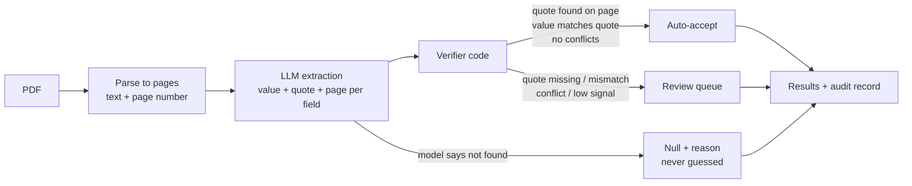

# Grounded extraction: evidence, verification, and abstain

> A confident wrong answer is worse than no answer.

**Status:** draft

Don't trust what the model says about its own confidence. Make it show evidence, check that evidence with code, and send anything unverified to a human.

## 1. The failure

<!-- Example: the model says the contract is worth $240,000, but that number is a penalty cap on page 7. -->

## 2. Why demos look perfect and production doesn't

<!-- Amendments, missing fields, distractor numbers. -->

## 3. Architecture

The design follows four rules:

1. **Evidence is required.** Every field returns a value, a quote and a page, or an explicit `not_found`.
2. **Code checks the evidence.** The quote must be on the cited page, the value must follow from the quote, and there must be no conflicting candidate.
3. **Abstaining is a valid output.** `not_found` scores better than a guess.
4. **Anything unverified goes to a human**, with the reason it failed.

## 4. Reliability: why not the model's own confidence?

## 5. Evaluation

<!-- Dataset categories; silent error rate as the headline metric. -->

## 6. Cost

## 7. Human-in-the-loop

<!-- What a review item contains and why the reason field matters. -->

## 8. Implementation

## 9. Results

| Metric | Baseline | Grounded |
|--------|----------|----------|
| Field accuracy | | |
| Silent error rate | | |
| Abstain correctness | | |
| Review rate | | |
| Citation validity | | |
| Cost per document | | |
| Latency p50 / p95 | | |

<!--  -->

## 10. Lessons learned

## Disclaimer

Independent learning project. All data is synthetic. Nothing here is based on employer work, documents, or data.
